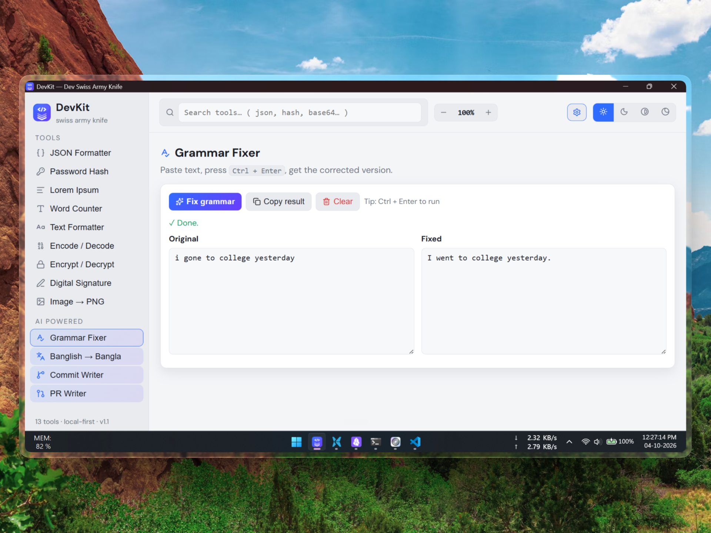
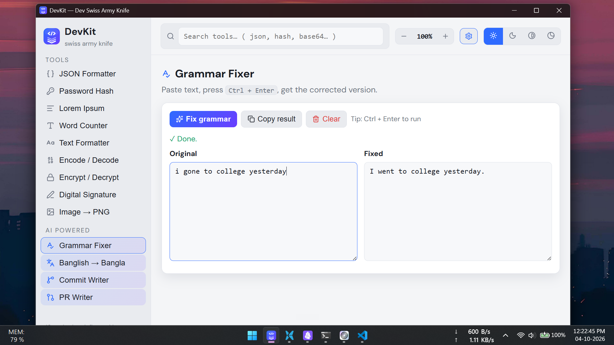
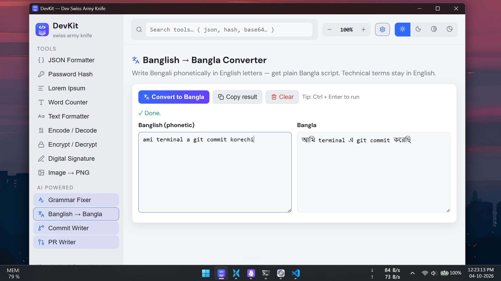
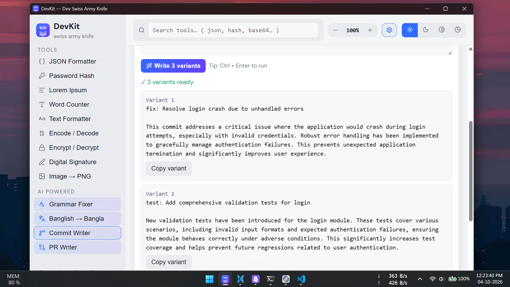
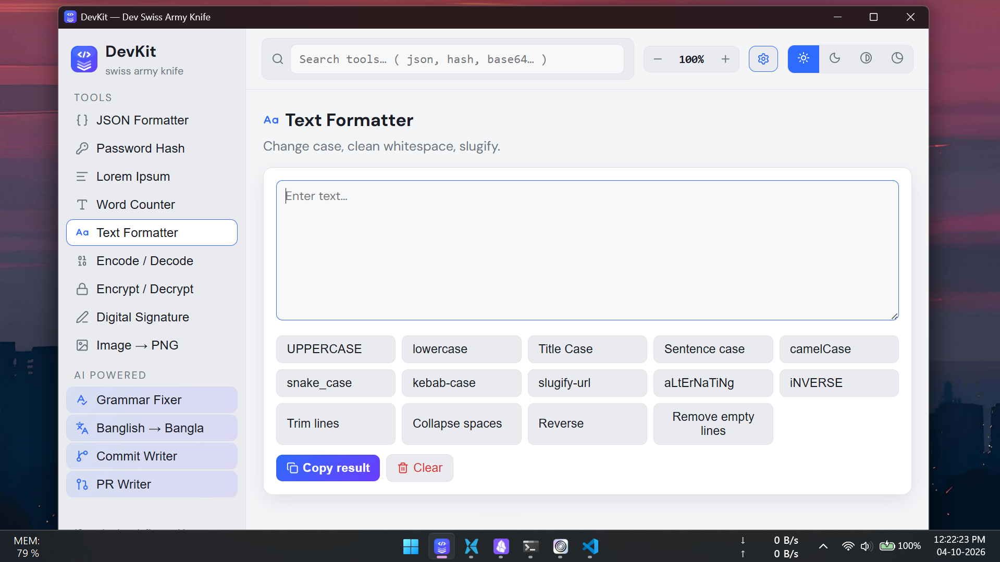

<p align="center" >

</p>

<div align="center">

# DevKit - Dev Swiss Army Knife

A local-first desktop toolbox: JSON formatter, password hashing, Lorem Ipsum, word counter,
text formatter, encoding/decoding, AES encrypt/decrypt, digital signatures, image→PNG,
plus 4 Gemini-AI tools (grammar fixer, Banglish→Bangla, commit writer, PR writer).



</div>

## Run it

```bash
npm install
npm run start
```

## Make the Windows installer

```bash
npm run dist
```

Produces `dist/DevKit Setup 1.0.0.exe` — share that single file, nothing else is needed.
First build downloads ~150MB of packaging tools; later builds are fast.

## Other commands

| Command             | What it does                                            |
| ------------------- | ------------------------------------------------------- |
| `npm run start`     | Open the app in development mode                        |
| `npm run dist`      | Build the Windows installer (`dist/DevKit Setup *.exe`) |
| `npm run dist:dir`  | Fast unpacked build (`dist/win-unpacked/`) for testing  |
| `npm run make-icon` | Regenerate `assets/icon.ico` from `assets/icon.png`     |

## Screenshots

|                                      |                                          |
| ------------------------------------ | ---------------------------------------- |
|  |  |
|   |            |

## Notes

- **AI tools** need a free Gemini API key: open the app → gear icon (topbar) → paste key,
  optionally set a model ID (default `gemini-flash-latest`). Stored only in your localStorage.
- Everything else works fully offline.
- `Ctrl +` / `Ctrl -` / `Ctrl 0` zooms; `Ctrl + wheel` too. Theme, font, and text size are in
  the topbar and the settings modal.
- The installer is unsigned, so Windows SmartScreen shows an "Unknown publisher" warning —
  click _More info → Run anyway_.
